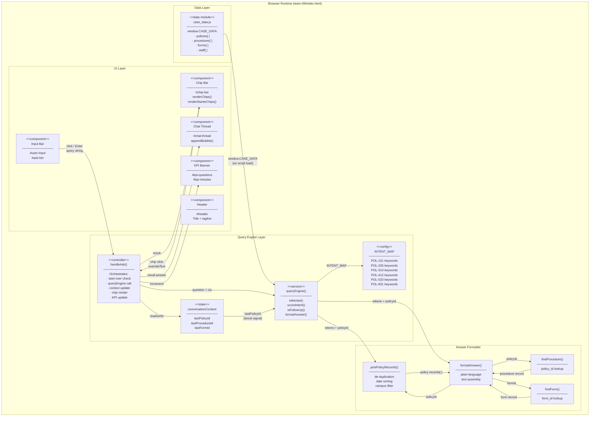

# UML Component Diagram — Ivy Tech Policy Assistant

> **Diagram type:** UML Component / Interaction diagram  
> **Scope:** Full runtime architecture of `team-09/index.html`

---



---

## Component Descriptions

### Data Layer

| Component | Responsibility |
|---|---|
| `case_data.js` | Static data module. Loaded via `<script>` tag. Exposes `window.CASE_DATA` containing all policies, procedures, forms, and staff. No network call — works fully offline. |

### UI Layer

| Component | Element | Responsibility |
|---|---|---|
| Header | `#header` | Displays Ivy Tech branding, tool title, and tagline. Static. |
| KPI Banner | `#kpi-banner` | Displays live session counters: questions answered and estimated minutes saved. Updated by `updateKPIs()` after every answer. |
| Chat Thread | `#chat-thread` | Scrollable message log. `appendBubble(role, text)` creates user and assistant bubbles with `fadeSlideIn` animation. |
| Chip Bar | `#chip-bar` | Renders quick-action chips after each answer via `renderChips(result)`. Renders starter chips on page load via `renderStarterChips()`. |
| Input Bar | `#input-bar` | Text input + Ask button. Fires `handleAsk()` on click and Enter keydown. |

### Query Engine Layer

| Component | Responsibility |
|---|---|
| `handleAsk()` | **Orchestrator.** Reads input, checks for start-over commands, calls `queryEngine`, appends answer bubble, updates context, re-renders chips, updates KPIs. |
| `queryEngine(question, ctx)` | **Core engine.** Tokenises question, scores all intents, applies context boost for follow-ups, delegates to `formatAnswer`. Returns `{ answer, relatedProcedure, relatedForm, policyId }` or `null`. |
| `conversationContext` | **In-memory state.** Holds `lastPolicyId`, `lastProcedureId`, `lastFormId` from the most recent successful answer. Cleared on start-over or failed lookup. |
| `INTENT_MAP` | **Configuration.** Array of `{ policyId, keywords[] }` objects — one entry per policy. Scoring compares question tokens against keyword arrays. |

### Answer Formatter

| Component | Responsibility |
|---|---|
| `pickPolicyRecords()` | Filters `CASE_DATA.policies` by `policy_id`. Sorts by `effective_date` descending and de-duplicates per section. Applies campus filter: returns Indianapolis-specific sections only when "indianapolis" is in tokens. |
| `findProcedure()` | Looks up the linked procedure in `CASE_DATA.procedures` by `policy_id`. |
| `findForm()` | Looks up a form record in `CASE_DATA.forms` by `form_id`. |
| `formatAnswer()` | Assembles the plain-language answer string from policy records, procedure steps, and form details. Applies the POL-205 medical/military exception override for form selection. |

---

## Data Flow — Example Interaction

```
User types: "Can I release grades to a parent?"
│
├─ handleAsk("Can I release grades to a parent?")
│   ├─ queryEngine(question, conversationContext)
│   │   ├─ tokenise() → ["can","i","release","grades","to","a","parent"]
│   │   ├─ scoreIntent(POL-101) → 3 hits (release, grades, parent)  ← winner
│   │   ├─ scoreIntent(POL-205) → 0
│   │   └─ formatAnswer("POL-101", tokens, false, false)
│   │       ├─ pickPolicyRecords("POL-101") → [section 1.2, section 1.4]
│   │       ├─ findProcedure("POL-101") → PR-05
│   │       └─ returns { answer: "...", relatedProcedure: "PR-05",
│   │                    relatedForm: "F-210", policyId: "POL-101" }
│   ├─ appendBubble("assistant", answer)
│   ├─ conversationContext ← { lastPolicyId: "POL-101", lastProcedureId: "PR-05", lastFormId: "F-210" }
│   ├─ renderChips({ relatedProcedure: "PR-05", relatedForm: "F-210" })
│   │   └─ chips: [Show me the steps] [What form do I need?] [Start over]
│   └─ updateKPIs() → questions: 1, minutes: 3
│
User clicks chip: "Show me the steps"
│
└─ handleAsk("Show me the steps")
    ├─ queryEngine("Show me the steps", { lastPolicyId: "POL-101", ... })
    │   ├─ tokenise() → ["show","me","the","steps"]
    │   ├─ isFollowUp() → true (contains "steps", length 4)
    │   ├─ scoreIntent(POL-101) raw=0 → boosted to 5 (context boost)  ← winner
    │   └─ formatAnswer("POL-101", tokens, wantProcedure=true, false)
    │       ├─ findProcedure("POL-101") → PR-05
    │       └─ returns numbered steps for "Release a record to a parent"
    └─ appendBubble("assistant", steps)
```
